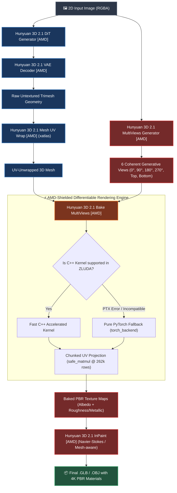
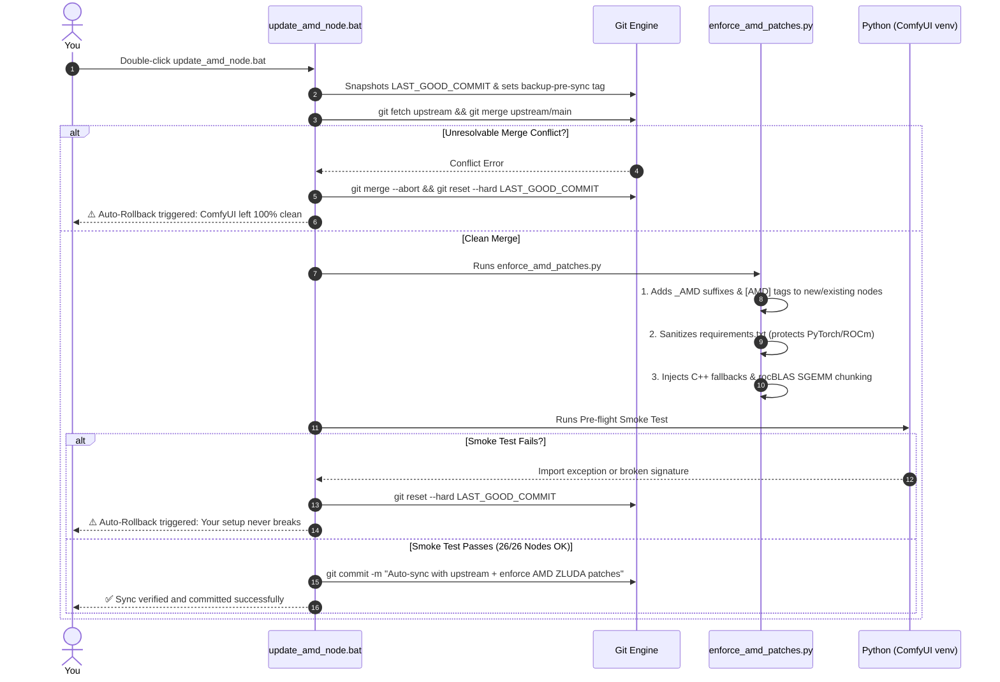

<div align="center">

# ⚡ ComfyUI-HY3Dv21-AMD
### Full-Pipeline Hunyuan3D 2.1 (Shape + Paint PBR) for AMD Radeon GPUs on Windows

[](https://github.com/Speedstu/CUDA-for-AMD-Windows)
[](https://github.com/comfyanonymous/ComfyUI)
[](https://huggingface.co/tencent/Hunyuan3D-2.1)
[](https://www.python.org/)
[](https://microsoft.com/windows)
[](https://paypal.me/mnecstream)
[](https://huggingface.co/tencent/Hunyuan3D-2.1)

<p align="center">
  <b>The first rock-solid, production-ready fork bringing the complete Hunyuan3D 2.1 pipeline (DiT geometry + multi-view Paint PBR texturing) to AMD Radeon graphics cards on Windows via ZLUDA.</b>
</p>

[Why This Fork Exists](#-the-technical-story-why-does-this-fork-even-exist) •
[Architecture](#-pipeline-architecture) •
[Auto-Updater](#-auto-update-system--amd-shielding) •
[Install Guide](#-step-by-step-installation) •
[Models & Checkpoints](#-folder-structure--official-model-weights) •
[Troubleshooting](#-troubleshooting--pro-tips) •
[Support Creator](#-support-this-project--buy-me-a-coffee) •
[Credits](#-licenses--shoutouts)

---

</div>

## 📖 The Technical Story: Why does this fork even exist?

> [!IMPORTANT]
> **The catch with native ComfyUI support:**  
> The native ComfyUI node for Hunyuan3D only loads `hunyuan_3d_v2.1.safetensors` — which means you **only get a plain, untextured clay mesh**. The most impressive half of Tencent's breakthrough research — the **`Hunyuan3D-Paint-v2-1`** pipeline that synthesizes 6 coherent multi-views and bakes true 4K PBR material maps (Albedo, Roughness, and Metallic) — was completely left on the table.

The community's go-to wrapper repo ([`visualbruno/ComfyUI-Hunyuan3d-2-1`](https://github.com/visualbruno/ComfyUI-Hunyuan3d-2-1)) modularized this pipeline for ComfyUI, but it was built **strictly for NVIDIA CUDA**:
1. Its core C++ extensions (`custom_rasterizer` and `DifferentiableRenderer`) are hardwired to CUDA's proprietary runtime and crashed immediately on Windows AMD setups.
2. Even when translated through **ZLUDA** ([`Speedstu/CUDA-for-AMD-Windows`](https://github.com/Speedstu/CUDA-for-AMD-Windows)), the UV back-projection kernel hit a silent driver-level landmine: a 1D grid launch bug in `rocBLAS` on RDNA architectures (like `gfx1201` / R9700). Any 2D `float32` matrix multiplication exceeding **524,288 rows ($2^{19}$, or $2\text{ MB}$ per column)** silently corrupted rows beyond that limit. For a $1024 \times 1024$ texture (with $\sim 618\text{k}$ UV texels), this left the bottom islands of the mesh unbaked, turning shoulders, legs, and chests into flat grey patches.

**This fork fixes every single one of those issues from the ground up:**
- **Hybrid Pure-PyTorch / C++ Rasterizer:** If CUDA kernels or PTX modules misbehave in ZLUDA, the rasterizer seamlessly hands off to a fast, vectorized pure-PyTorch backend (`torch_backend.py`) without crashing your ComfyUI session.
- **Chunked Linear Algebra (`safe_matmul`):** Large UV projections are sliced into safe chunks of $262,144$ rows. This guarantees **exact mathematical parity with CPU ($1.78 \times 10^{-7}$ float error)** and completely eliminates missing texture patches.
- **Zero-Collision Isolation (`[AMD]`):** Every internal class key and display name is tagged with `_AMD` and `[AMD]`. You can keep upstream installed side-by-side without signature collisions.
- **Bulletproof Self-Maintaining Updater:** Pull improvements from upstream whenever you want without losing any of your AMD tweaks.

---

## 📊 Quick Comparison

| Feature | Native ComfyUI | Upstream Repo (CUDA) | **ComfyUI-HY3Dv21-AMD (This Fork)** |
| :--- | :---: | :---: | :---: |
| **Geometry Generation (DiT Flow Matching)** | ✅ | ✅ | ✅ |
| **Full PBR Texturing (Albedo, Roughness, Metallic)** | ❌ *(Clay mesh only)* | ✅ | ✅ |
| **AMD Radeon Support on Windows** | ⚠️ *(Partial ROCm)* | ❌ *(NVIDIA only)* | ✅ **Tuned for ZLUDA / ROCm** |
| **Pure-PyTorch C++ Fallback (Zero Crashes)** | ❌ | ❌ | ✅ **Automatic & transparent** |
| **`rocBLAS` SGEMM Overfill Protection (`gfx1201`)** | ❌ | ❌ | ✅ **Active chunked matmul** |
| **Self-Healing Auto-Updater with Rollback** | ❌ | ❌ | ✅ **`update_amd_node.bat`** |
| **Ready-to-use Workflows Included** | Limited | Standard | ✅ **Patched AMD workflows included** |

---

## 🏗️ Pipeline Architecture



---

## 🔄 Auto-Update System & AMD Shielding

Ever had an upstream `git pull` wipe out your local hardware fixes or break your workflows? This repository features an intelligent, idempotent patching engine that lets you pull fresh features and nodes from **visualbruno** while permanently locking down all our AMD enhancements.



### How to update in one click
Simply run:
```bat
update_amd_node.bat
```
Or from your shell:
```powershell
# Standard venv:
<COMFYUI_ROOT>\venv\Scripts\python.exe update_from_upstream.py

# Portable ComfyUI:
<COMFYUI_ROOT>\python_embeded\python.exe update_from_upstream.py
```

---

## 📥 Step-by-Step Installation

### 1. Requirements
- **Windows 11 (64-bit)**
- **AMD Radeon GPU** (RX 6000, 7000 series, or Radeon AI PRO / 8000/9000 series on RDNA3 or RDNA4).
- **ZLUDA for AMD on Windows:** Installed and verified via [`Speedstu/CUDA-for-AMD-Windows`](https://github.com/Speedstu/CUDA-for-AMD-Windows).
- **ComfyUI Virtual Environment** running Python 3.11 or 3.12 with your working ZLUDA/ROCm PyTorch build.

> [!CAUTION]
> **DO NOT run a blind `pip install -r requirements.txt`!** A generic pip run can overwrite your specialized ROCm/ZLUDA `torch` and `torchvision` wheels with vanilla CPU/CUDA packages. Use our pre-filtered command below.

### 2. Clone into ComfyUI
In your ComfyUI custom nodes directory:
```bash
cd <COMFYUI_ROOT>/custom_nodes
git clone https://github.com/mnector/ComfyUI-HY3Dv21-AMD.git
```

### 3. Install Auxiliary Dependencies
Run this in your ComfyUI environment:
```powershell
# Standard venv:
<COMFYUI_ROOT>\venv\Scripts\python.exe -m pip install trimesh pymeshlab pygltflib xatlas open3d omegaconf pyyaml configargparse transformers diffusers accelerate pytorch-lightning opencv-python huggingface-hub safetensors scikit-image timm meshlib spandrel

# Or if using ComfyUI portable:
<COMFYUI_ROOT>\python_embeded\python.exe -m pip install trimesh pymeshlab pygltflib xatlas open3d omegaconf pyyaml configargparse transformers diffusers accelerate pytorch-lightning opencv-python huggingface-hub safetensors scikit-image timm meshlib spandrel
```

---

## 📁 Folder Structure & Official Model Weights

Download the official model weights from Hugging Face ([`tencent/Hunyuan3D-2.1`](https://huggingface.co/tencent/Hunyuan3D-2.1)) and place them into the following directories:

```
[ComfyUI_Root]/
├── models/
│   ├── diffusion_models/
│   │   └── hunyuan3d-dit-v2-1.ckpt        <-- Shape DiT weights
│   ├── vae/
│   │   └── hunyuan3d-vae-v2-1.ckpt        <-- 3D VAE decoder weights
│   └── diffusers/
│       └── hunyuan3d-paintpbr-v2-1/       <-- Full Paint PBR diffusers pipeline
│           ├── unet/
│           ├── scheduler/
│           └── ...
└── custom_nodes/
    └── ComfyUI-HY3Dv21-AMD/
        └── hy3dpaint/
            └── ckpt/
                └── RealESRGAN_x4plus.pth   <-- UV texture upscaler (67 MB)
```

> [!TIP]
> Download `RealESRGAN_x4plus.pth` directly into `hy3dpaint/ckpt/`. Our strict `.gitignore` and security `pre-commit` hook will ensure you never accidentally push heavy weights or 3D test assets to GitHub if you make your own commits.

---

## 🛠️ Troubleshooting & Pro Tips

<details>
<summary><b>🔧 1. Recommended ZLUDA startup flags (--disable-smart-memory)</b></summary>

When running large 3D generative diffusion models (`DiT` + `Paint PBR UNet`), ComfyUI may try to swap weights aggressively between system RAM and VRAM. Under ZLUDA, this causes severe latency spikes and HIP memory fragmentation. Add `--disable-smart-memory` to your launch command or script (e.g. `comfyui_zluda.bat --disable-smart-memory`):
```bat
@echo off
set ZLUDA_ENABLE_DYNAMIC_VRAM=1
set HIP_VISIBLE_DEVICES=0
python main.py --disable-smart-memory --highvram
```
`--disable-smart-memory` keeps allocations stable across the translation layer.
</details>

<details>
<summary><b>🔧 2. Forcing the Rasterizer Backend (PyTorch vs. C++)</b></summary>

While backend selection is automatic with dynamic fallback, you can force a specific mode using environment variables:
- **Force pure PyTorch on GPU:**  
  `set HY3D_RASTER_BACKEND=torch`
- **Force CPU execution (for reference benchmarks):**  
  `set HY3D_RASTER_BACKEND=cpu`
</details>

<details>
<summary><b>🔧 3. The `gfx1201` (RDNA4 / R9700) 524k-Row SGEMM Limit</b></summary>

If you are developing custom nodes on RDNA4 with ROCm/ZLUDA, keep in mind that `rocBLAS` fails silently on FP32 matrix multiplications where dimension $M > 524,288$. This repo solves it inside [`camera_utils.py`](hy3dpaint/DifferentiableRenderer/camera_utils.py) and [`MeshRender.py`](hy3dpaint/DifferentiableRenderer/MeshRender.py) using [`safe_matmul`](hy3dpaint/DifferentiableRenderer/camera_utils.py) chunking. Make sure any additional matrix transforms keep this chunking intact.
</details>

---

## ☕ Support This Project / Buy Me a Coffee

Making modern generative 3D pipelines work smoothly on AMD graphics cards under Windows isn't easy. It took countless hours of reverse-engineering CUDA kernels, patching ZLUDA bottlenecks, digging through low-level `rocBLAS` assembly to squash silent matrix overflows, and crafting pure-PyTorch fallbacks so the community doesn't have to deal with crashes.

If this fork saved you time, brought your Radeon GPU to life in ComfyUI, or helped your creative workflow, consider buying me a coffee to support continued development and maintenance!

<div align="center">

<a href="https://paypal.me/mnecstream" target="_blank">
  
</a>

<p>
  <b>Every contribution helps keep this repository actively maintained, tested, and updated!</b><br/>
  👉 <a href="https://paypal.me/mnecstream">paypal.me/mnecstream</a>
</p>

</div>

---

## 🤝 Licenses & Shoutouts

This project builds upon the hard work of extraordinary researchers and open-source pioneers:

- **[Tencent Hunyuan3D Team](https://github.com/Tencent-Hunyuan/Hunyuan3D-2.1):** Creators of the foundational **Hunyuan3D 2.1** architecture, released under the *Tencent Hunyuan Community License*.
- **[visualbruno](https://github.com/visualbruno/ComfyUI-Hunyuan3d-2-1):** For creating the modular ComfyUI integration that served as the base for this fork.
- **[Speedstu](https://github.com/Speedstu/CUDA-for-AMD-Windows) and the ZLUDA project:** For breaking hardware barriers and making AI computation viable on AMD GPUs in Windows.
- **[kijai](https://github.com/kijai/ComfyUI-Hunyuan3DWrapper):** For pioneering 3D generative wrappers in ComfyUI.
- **[xatlas-python](https://github.com/mworchel/xatlas-python):** For high-resolution mesh UV unwrapping.

---

<div align="center">
  <b>ComfyUI-HY3Dv21-AMD</b> • Built with passion for open hardware and the AMD AI community.
</div>
